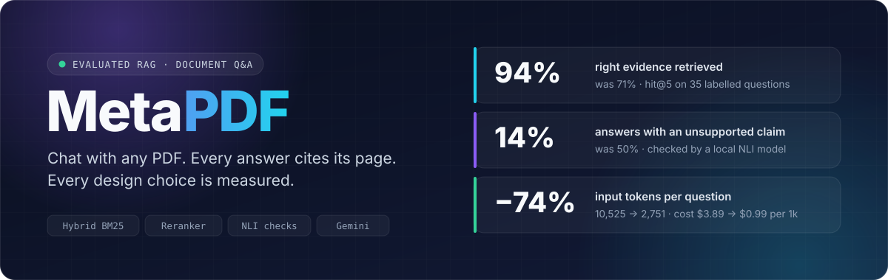
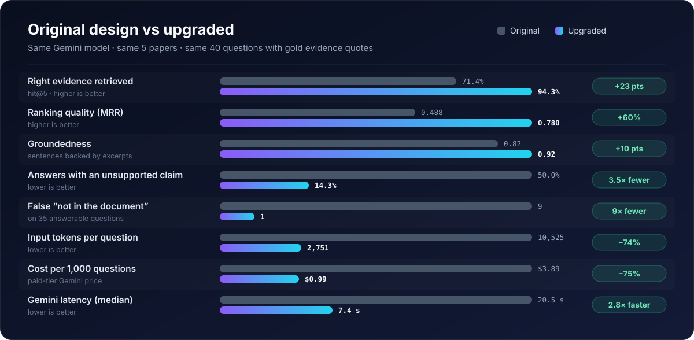
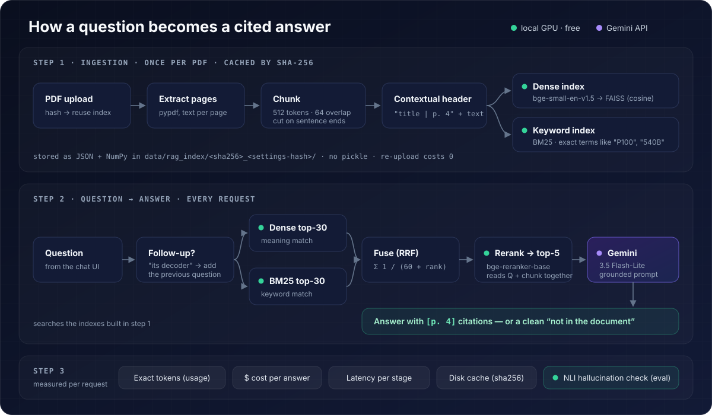
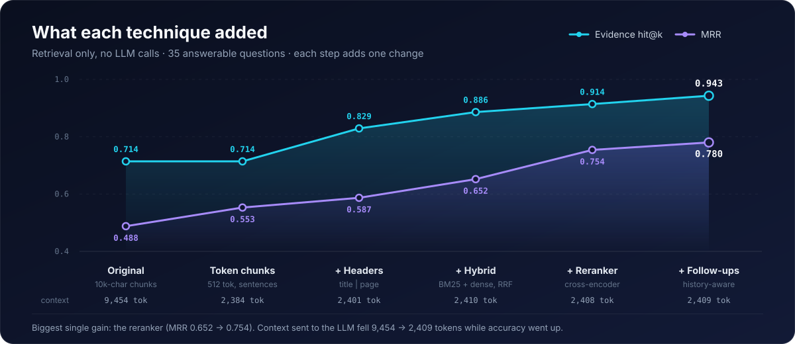

<p align="center">
  
</p>

<p align="center">
  
  
  
  
  
  
  
</p>

<p align="center">
  <a href="#-results">Results</a> ·
  <a href="#-how-it-works">How it works</a> ·
  <a href="#-the-rag-concepts-explained-simply">Concepts</a> ·
  <a href="#-quick-start">Quick start</a> ·
  <a href="#-evaluation">Evaluation</a> ·
  <a href="#-contributing">Contributing</a> ·
  <a href="docs/RAG_UPGRADE_JOURNAL.md">Journal</a>
</p>

---

**MetaPDF** lets you upload a PDF and ask questions about it. Each answer cites the pages it came from. When the
answer isn't in the document, it says so instead of making something up.

What sets it apart from a tutorial RAG app is that **every design choice is measured**. A fixed test set of
**5 research papers and 40 questions**, each with gold evidence quotes, scores retrieval quality, answer quality,
hallucination rate, tokens, cost and latency. The original design and the upgraded one are scored on the same set.

The app also includes two smaller tools: a **PDF summarizer** (local BART, with OCR for scanned pages) and an
**Office → PDF converter** (DOCX, PPTX, XLSX, TXT).

> 📘 **Want the full story?** [`docs/RAG_UPGRADE_JOURNAL.md`](docs/RAG_UPGRADE_JOURNAL.md) explains every decision,
> experiment, mistake and fix, step by step, written for a student.

## 📊 Results

<p align="center">
  
</p>

The original prompt told the model to fall back on "relevant knowledge". So on questions the paper can't answer, it
said the answer wasn't there and then answered from memory anyway. The upgraded system refuses cleanly and cites a
page for everything it states.

<details>
<summary><b>Same results as a table</b></summary>

| Metric | Original | Upgraded |
|---|---|---|
| Right evidence retrieved (hit@k, 35 answerable questions) | 71.4% | **94.3%** |
| Ranking quality (MRR) | 0.488 | **0.780** |
| Answers containing an unsupported claim | 50.0% | **14.3%** |
| Groundedness (answer sentences supported by the excerpts) | 0.82 | **0.92** |
| Unanswerable questions, rubric score 0–2 | 1.0 | **2.0** |
| False "not in the document" on answerable questions | 9 / 35 | **1 / 35** |
| Key-fact coverage | 77.7% | **81.7%** |
| Input tokens per question | 10,525 | **2,751 (−74%)** |
| Output tokens per answer | 292 | **65 (−78%)** |
| Cost per 1,000 questions (paid-tier price) | $3.89 | **$0.99 (−75%)** |
| Gemini latency, median | 20.5 s | **7.4 s** |

Both systems use the same Gemini model, because the original one has been retired.

</details>

## 🧠 How it works

<p align="center">
  
</p>

Only the final answer calls an API. Embeddings, the reranker and the hallucination checker all run locally, on
the GPU when there is one. Gemini responses are disk-cached by a SHA-256 of the prompt, so re-running costs zero
requests. That is why the whole project was built and evaluated on the Gemini free tier.

## 🎓 The RAG concepts explained simply

| Concept | In plain English | What it did here |
|---|---|---|
| **Chunking** | A whole paper is too long to send to the model, so it is cut into pieces. Smaller pieces mean the model reads less irrelevant text. | 10,000-char chunks became 512-token chunks cut at sentence ends, each with its page range. Context per question fell from **9,454 to 2,384 tokens** and MRR went *up* (0.488 → 0.553). |
| **Contextual headers** | A chunk that says "our model gets 28.4 BLEU" doesn't say *which* model. Prefixing the paper title and page fixes that. | Every chunk is indexed as `"title \| p. 4" + text`. Hit rate **0.71 → 0.83**, the biggest jump in hit rate. |
| **Dense retrieval** | Turn text into vectors so "how fast was training" finds "3.5 days on 8 P100 GPUs" even with no shared words. | `bge-small-en-v1.5` embeddings in a FAISS inner-product index. |
| **BM25 (keyword search)** | Old-school search on exact words. Great for names and numbers like `WMT 2014`, `540B`, `P100`, which embeddings blur. | `rank_bm25`. On this corpus BM25 *alone* beat dense alone (hit 0.886 vs 0.829). |
| **Hybrid + RRF** | Run both searches and merge the two ranked lists. Reciprocal Rank Fusion scores each chunk `Σ 1/(60 + rank)`, so chunks both searches like rise to the top. No score calibration needed. | Top-30 from each, fused. Removing BM25 from the final system drops MRR **0.78 → 0.72**. |
| **Cross-encoder reranker** | The first search is fast but rough. A reranker reads the question and each candidate *together* and re-scores them carefully. Slower, so it only sees the top 30. | `bge-reranker-base` picks the final 5. **The biggest single gain: MRR 0.65 → 0.75**, for about 380 ms on a laptop GPU. |
| **History-aware retrieval** | "What about its decoder?" means nothing on its own. Short or pronoun-led follow-ups get the previous question attached before searching. | Follow-up hit rate 0.60 → 0.80. Overall hit **0.914 → 0.943**. |
| **Grounded prompt + citations** | Tell the model to use *only* the excerpts, cite `[p. N]`, and use one exact sentence when the answer isn't there. | False refusals **9 → 1**, unanswerable-question score **1.0 → 2.0**, answers 190 → 39 words. |
| **Hallucination check (NLI)** | A second, independent model asks "does this excerpt actually support this sentence?" for every sentence of the answer. The generator never grades itself. | DeBERTa-v3 NLI ensemble on sentence windows, run offline. Unsupported answers **50.0% → 14.3%**. |
| **Token & cost accounting** | You can't optimise what you don't measure. | Exact tokens from Gemini `usage_metadata`, a price table, and per-stage latency, logged to `data/metrics/requests.jsonl` and shown under every answer. |

### What each technique added

<p align="center">
  
</p>

Each step changes one thing, so every gain can be traced to a single technique. Sweeps (chunk size, k, embedder) are in
the [full ablation table](eval/results/retrieval_ablation.md). One surprise: `bge-base`, a model 3× larger, and
`all-MiniLM` score **exactly the same** as `bge-small` once BM25 and the reranker are in place. So the smallest one
stays.

## 🧰 Tech stack

| Layer | Choice | Why |
|---|---|---|
| Web app | Flask (chat, converter), Streamlit (summarizer) | Simple, and the chat route is a thin layer over `RAGService` |
| PDF text | `pypdf`, per page | Keeps page numbers for citations |
| Embeddings | `BAAI/bge-small-en-v1.5` (sentence-transformers) | Free and local, and as accurate as models 3× larger on this eval |
| Vector index | FAISS `IndexFlatIP` | Exact search, tiny per-document indexes |
| Keyword index | `rank_bm25` (BM25Okapi) | Catches exact terms and numbers |
| Reranker | `BAAI/bge-reranker-base` cross-encoder | Biggest single quality gain |
| LLM | `gemini-3.5-flash-lite` via `google-genai` | The only API call; 60 s timeout, back-off retries, disk cache |
| Hallucination check | `cross-encoder/nli-deberta-v3-base` + `-small` | Offline and independent of the generator |
| Storage | `data/rag_index/<sha256>_<settings-hash>/` as JSON + NumPy | No pickle; re-uploading a file costs 0; changing a setting rebuilds automatically |
| Hardware | Any CPU; CUDA if available (built on an RTX 2050, 4 GB) | Models load in fp16 on GPU |

## 🚀 Quick start

**1. Clone and create a virtual environment**

```bash
git clone https://github.com/KalpeshEragi/MetaPDF.git
cd MetaPDF
python -m venv venv
```

```bash
venv\Scripts\activate
```

On Linux or macOS, use `source venv/bin/activate` instead.

**2. (Optional) Install PyTorch with CUDA**, for NVIDIA GPUs. Skip this to run on CPU.

```bash
pip install torch==2.13.0+cu126 torchvision==0.28.0+cu126 --index-url https://download.pytorch.org/whl/cu126
```

**3. Install the dependencies**

```bash
pip install -r requirements.txt
```

**4. Add your keys.** Copy `.env.example` to `env/.env`, then set:

- `GOOGLE_API_KEY`: a free key from [Google AI Studio](https://aistudio.google.com/apikey)
- `FLASK_SECRET_KEY`: any long random string

**5. Run**

```bash
python app.py
```

Open **http://localhost:5000/chat**, upload a PDF and ask away. The first upload downloads the local models once
(about 0.5 GB).

For the summarizer, run this in a second terminal:

```bash
streamlit run App/streamlit_app/stream_app.py
```

### Configuration

Every setting lives in [`App/rag/config.py`](App/rag/config.py) and can be overridden in `env/.env`:

| Variable | Default | Meaning |
|---|---|---|
| `RAG_LLM_MODEL` | `gemini-3.5-flash-lite` | Answer model |
| `RAG_EMBEDDING_MODEL` | `BAAI/bge-small-en-v1.5` | Dense embedder |
| `RAG_RERANKER_MODEL` | `BAAI/bge-reranker-base` | Cross-encoder |
| `RAG_RETRIEVAL_MODE` | `hybrid` | `dense`, `bm25` or `hybrid` |
| `RAG_USE_RERANKER` | `1` | Turn the reranker on or off |
| `RAG_CHUNK_TOKENS` / `RAG_CHUNK_OVERLAP_TOKENS` | `512` / `64` | Chunk size and overlap |
| `RAG_FINAL_K` | `5` | Excerpts sent to the LLM |
| `RAG_MAX_OUTPUT_TOKENS` | `512` | Answer length cap |
| `RAG_DEVICE` | `auto` | `auto`, `cuda` or `cpu` |
| `METAPDF_DATA_DIR` | `data/` | Where indexes, cache and metrics go |
| `MAX_UPLOAD_MB` | `50` | Upload size limit |

## 🧪 Evaluation

The evaluation reuses exactly the same `RAGService` the web app runs, so the numbers describe the real system.

Unit and route tests (no network, no GPU, no API key):

```bash
python -m pytest tests -q
```

Retrieval ablation (no API calls, about 3 minutes on a GPU):

```bash
python eval/run_retrieval_ablation.py
```

Before/after answer evaluation (about 80 Gemini calls, cached and resumable):

```bash
python eval/run_generation_eval.py
```

- **Test set:** [`eval/questions.jsonl`](eval/questions.jsonl). 40 questions over 5 arXiv papers, of which 35 are
  answerable and 5 are deliberately unanswerable. Each answerable question has gold evidence quotes and key facts.
- **Rubric:** [`eval/RUBRIC.md`](eval/RUBRIC.md).
- **Results:** [`eval/results/`](eval/results).
- **Getting the papers:** they are public but kept out of git. Download them with the URLs in
  [`eval/corpus/manifest.json`](eval/corpus/manifest.json) into `eval/corpus/pdfs/`.
- **Hallucination scoring** splits each answer into sentences, removes citations and filler, and asks an NLI
  ensemble whether any 1–3-sentence window of the retrieved excerpts supports each one. The checker was tested on
  hand-written true and false claims before any score was trusted.

## 📁 Project structure

```
App/
├── rag/                  ← the RAG pipeline (shared by the web app and the evaluation)
│   ├── config.py         all settings + Gemini price table
│   ├── extract.py        PDF → per-page text, title detection
│   ├── chunking.py       sentence-aligned token chunks with page ranges (+ legacy chunker)
│   ├── index.py          FAISS + BM25 per document, JSON/NumPy persistence
│   ├── retrieve.py       dense / BM25 / hybrid RRF / cross-encoder rerank
│   ├── prompts.py        grounded prompt with citations (+ original prompt for comparison)
│   ├── llm.py            Gemini client: exact tokens, cost, cache, retries, quota handling
│   ├── faithfulness.py   local NLI hallucination checker
│   └── pipeline.py       RAGService.ingest() / .ask()
├── chat_app.py           Flask chat routes (+ /chat/stats for token and cost totals)
├── streamlit_app/        BART summarizer UI
├── ocr_processor.py      OCR for scanned pages
└── *_converter.py        Office/TXT → PDF
eval/                     questions, rubric, ablation + generation scripts, results
docs/                     upgrade journal + README diagrams
tests/                    unit + route tests
```

## 🤝 Contributing

Contributions are welcome, from typo fixes to new retrieval experiments.

1. **Fork** the repo and clone your fork.
2. **Create a branch**: `git checkout -b feat/short-description`.
3. **Make your change**, and run `python -m pytest tests -q`.
4. **If you touch retrieval, prompts or chunking**, run `python eval/run_retrieval_ablation.py` and put the
   before/after numbers in your PR. Changes that move the metrics are the most interesting kind.
5. **Commit** using [Conventional Commits](https://www.conventionalcommits.org/) (`feat:`, `fix:`, `docs:`,
   `eval:`, `test:`), then **open a pull request** against `main`.

Ideas worth picking up: query rewriting, multi-document chat, scanned-PDF support in the chat, streaming answers, and
a bigger eval set. See [CONTRIBUTING.md](CONTRIBUTING.md) for setup details and ground rules.

## ⚠️ Known limitations

- **The eval set is small** (5 papers, 40 questions), so differences below about 6 points are within noise.
- **Hallucination scores come from an automatic NLI model, not human judgement.** It was checked on hand-made cases
  and spot-checked by hand, but it can miss claims that combine several excerpts.
- **The Office converters need Windows with Microsoft Office.** The chat and summarizer are cross-platform.
- **Scanned PDFs:** the chat needs a text layer, while the summarizer has OCR (which needs Poppler).

## 📸 Interface

| Home | Chat with PDF | Summarizer | Converter |
|---|---|---|---|
| .png) | .png) | .png) | .png) |

## 📝 License

[MIT](LICENSE). Built by [@KalpeshEragi](https://github.com/KalpeshEragi).
